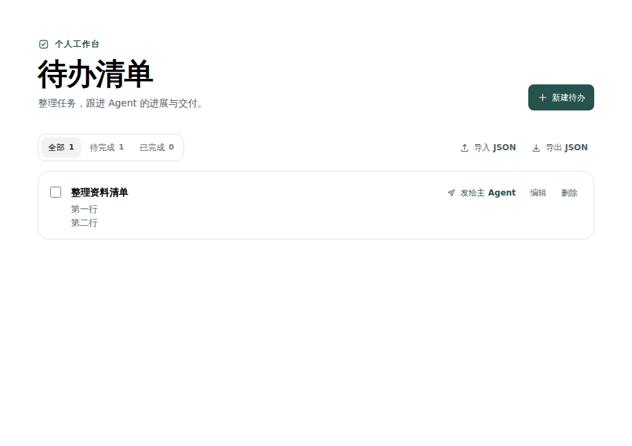
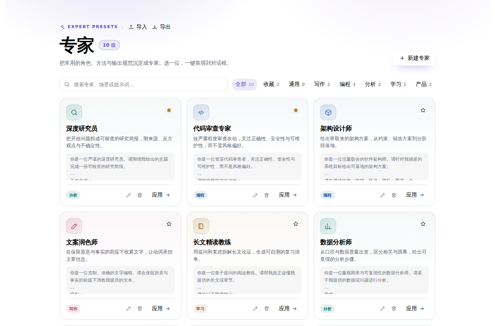
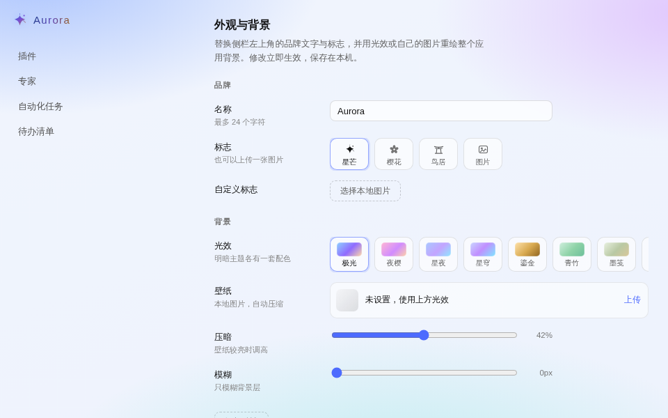

# DeepSeek Harness 插件合集

[](https://github.com/hafung/deepseek-harness-plugins/actions/workflows/test.yml)
[](LICENSE)

为 [DeepSeek Harness](https://github.com/deepseek-ai/deepseek-harness) 开发的社区插件：管理待办、复用专家提示词、自动筛选每日热点，以及自定义应用外观。

Community plugins for DeepSeek Harness: todos, reusable expert prompts, a daily RSS hotspot briefing, and appearance customization.

每个插件都可以单独安装、启用和升级，按各自版本发布。此项目由社区维护，与 DeepSeek 官方无隶属关系。

## 插件一览

| 插件 | 当前版本 | 能做什么 | 开发对照的 Desktop 版本 |
| --- | --- | --- | --- |
| [待办清单](plugins/dsh-todo-list/README.md) | `1.3.0` | 管理本地待办，后台派发给主 Agent，跟踪会话状态，导入导出 JSON | `0.2.0-rc.2` |
| [专家](plugins/dsh-experts/README.md) | `1.0.0` | 管理专家提示词，分类、收藏与搜索，一键载入对话草稿，导入导出 JSON | `0.2.2-rc.1` |
| [热点](plugins/dsh-hotspot/README.md) | `1.2.0` | 274 个精选 RSS 信源（含 Hacker News）、72 小时时效窗口、AI 精排 Top 30、一手来源优先、自媒体选题评分、收藏与看过归档、网感转写 | `0.2.2-rc.1` |
| [极光主题](plugins/dsh-aurora/README.md) | `0.5.1` | 自定义侧栏品牌与标志，八种背景光效、本地壁纸、模糊与压暗 | `0.2.2-rc.1` |

上表列出各插件开发时对照的版本，其他 Harness 版本请自行验证。预览版的插件接口可能变化；遇到问题请附上 Harness 版本和复现步骤，提交 [Issue](https://github.com/hafung/deepseek-harness-plugins/issues)。

## 界面预览

以下图片由浏览器测试生成，展示插件在模拟 Harness 服务下的界面；桌面端布局和字体可能略有不同。

### 待办清单



### 专家



### 极光主题



## 安装

**不需要发布或安装 npm 包，也不需要安装 Node.js 或 pnpm。** 下载插件文件后，通过 Harness 的插件管理界面安装即可。

### 方式一：下载单个插件

1. 打开 [Releases](https://github.com/hafung/deepseek-harness-plugins/releases)，选择需要的插件及版本。
2. 下载该版本的 `dsh-*.zip` 附件，解压到一个准备长期保留的目录。
3. 在 Harness 打开 **插件 → 添加插件**，输入解压后包含 `package.json` 的插件目录的绝对路径。
4. 点击 **安装 → 立即启用**。

例如，解压后的目录是 `D:\HarnessPlugins\dsh-experts\package.json`，安装时填写 `D:\HarnessPlugins\dsh-experts`。安装后保留此目录。

### 方式二：克隆整个仓库

```sh
git clone https://github.com/hafung/deepseek-harness-plugins.git
```

也可以点击仓库页面的 **Code → Download ZIP** 并解压。然后在 Harness 中分别添加需要的插件目录：

```text
deepseek-harness-plugins/
└── plugins/
    ├── dsh-todo-list/   ← 待办清单
    ├── dsh-experts/     ← 专家
    ├── dsh-hotspot/     ← 热点
    └── dsh-aurora/      ← 极光主题
```

选择具体的插件子目录，仓库根目录不是可安装的插件。

## 使用与数据

- **待办清单**：从左侧栏打开；「发给主 Agent」会在默认工作区创建会话，清单页面保持打开，执行完成后由你验收。
- **专家**：从左侧栏打开；「应用」会把提示词写入当前会话草稿，已有内容时追加，不自动发送。
- **热点**：从左侧栏打开；首次会并发扫描 274 个精选 RSS 源，客户端打开期间每小时自动更新 Top 30。卡片可「已知晓」归档到看过、点星标收藏；「网感转写」会把非中文原文改写成简中文章。
- **极光主题**：打开 **账号菜单 → 设置 → 皮肤**；会替换官方侧栏品牌，停用或卸载后恢复。

插件设置和清单保存在本机。待办清单与专家提供 JSON 导出，建议升级前备份；会话、附件由 Harness 自己保存。更多行为及限制见各插件的说明。

## 更新与卸载

克隆安装可在仓库执行 `git pull`；下载包安装可下载新版本并解压到插件目录。然后在 Harness 插件管理中重新安装并启用，必要时重启应用以重新加载客户端代码。

从其他目录迁移时，先卸载旧安装，再添加新目录。同一 Harness 配置下，当前版本沿用已有插件存储键；清理 Harness 应用数据会影响本地存档。

插件互不依赖，可以单独停用或卸载。

## 开发与测试

开发需要 Node.js `>=22.13.0` 和根目录 `package.json` 声明的 pnpm 版本。首次安装依赖与测试浏览器：

```sh
pnpm install --frozen-lockfile
pnpm exec playwright install chromium
pnpm test
```

Linux 上若缺少浏览器系统库，可改用 `pnpm exec playwright install --with-deps chromium`。

单独运行某个插件的测试：

```sh
pnpm test:todo
pnpm test:experts
pnpm test:hotspot
pnpm test:aurora
```

Windows 上也可以使用已安装的 Edge，在 PowerShell 中执行：

```powershell
$env:DSH_SMOKE_BROWSER_CHANNEL = 'msedge'
pnpm test
```

测试使用真实 React 页面和模拟 Harness 服务，覆盖交互、数据保留、会话派发、草稿载入及主题设置。浏览器测试通过后，还应在目标 Harness 桌面版本中验收安装、启用和卸载。

- [插件开发笔记](docs/harness-plugin-development.md)
- [打包与发布](docs/releasing.md)

## 许可证

[MIT](LICENSE) © 2026 hafung
